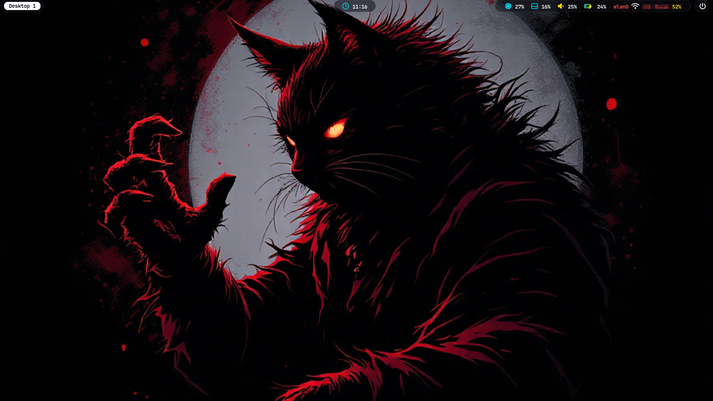
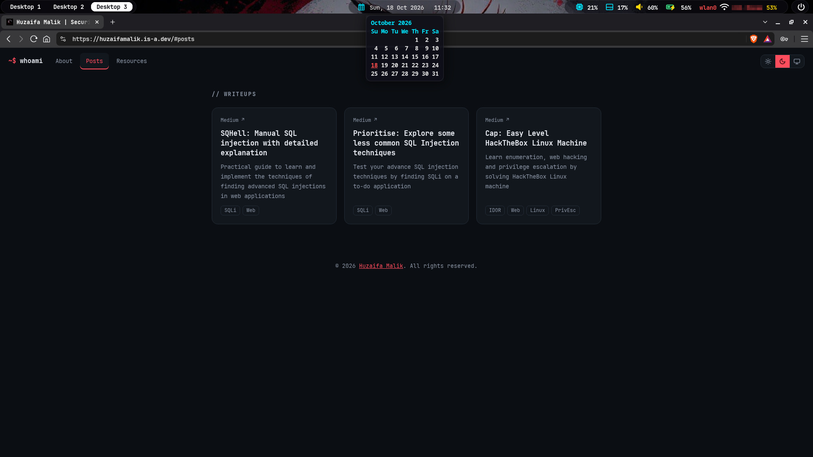

<div align="center">

# 🌌 Waybar KDE Transparent

**A dark, glassy, fully transparent [Waybar](https://github.com/Alexays/Waybar) setup for KDE Plasma on Wayland**


</div>

 

---
## ✨ Features

- 🪟 **Transparent dark glass pills** with soft borders and rounded corners
- 🖥️ **KDE virtual desktop buttons** (`Desktop 1`, `Desktop 2`, …), clickable, with white-on-black highlight for the selected / hovered desktop
- 📊 **System stats:** CPU, RAM, Volume, Battery and WiFi
- 🔋 **Smart battery icon:** light green normally, orange below 40%, blinking red at 15% or less, green with a yellow ⚡ while charging
- 📶 **WiFi details:** interface name, SSID and a signal percentage colored by strength
- 🔊 **Volume control:** scroll to adjust, click to mute, right-click for KDE audio settings
- 🕒 **Centered, clickable clock:** shows time by default, click to toggle date + time, hover for a calendar
- ⏻ **Power button** that opens KDE's native logout / shutdown dialog
- 📏 **Compact 28 px bar** sitting flush against the top edge of the screen
- 🔤 **Bold text and enlarged Nerd Font icons** throughout

## 🧩 Layout

```
┌─────────────────────────────────────────────────────────────────────────────────┐
│ [Desktop 1][Desktop 2]…            Clock            CPU  RAM  VOL  BAT  WiFi │ ⏻ │
└─────────────────────────────────────────────────────────────────────────────────┘
   left                              center                          right
```

## 🎨 Color Scheme

| Element                   | Color                               |
| ------------------------- | ----------------------------------- |
| Bar / pill background     | `rgba(15, 15, 25, 0.55)` (glass)    |
| Values / percentages      | `#ffffff` (white)                   |
| Icons (CPU, RAM, clock)   | `#00e5ff` (cyan)                    |
| Battery icon (normal)     | `#90ee90` (light green)             |
| Volume icon, charge sign  | `#ffd60a` (yellow)                  |
| Power / WiFi icons        | `#ffffff` (white)                   |
| Interface name, SSID, alerts | `#ff4d4d` (red)                  |
| Battery < 40% / ≤ 15%     | `#ff9f1a` (orange) / `#ff4d4d` (red)|
| Battery charging / full   | `#3ddc84` (green)                   |
| Selected / hovered desktop | `#ffffff` background, `#0b0b12` text |

## 📋 Requirements

### System

| Component          | Requirement                                           |
| ------------------ | ----------------------------------------------------- |
| **OS**             | Arch Linux (or an Arch-based distro with `pacman`)    |
| **Desktop**        | KDE Plasma 6 (uses `qdbus6` and `kcmshell6`)          |
| **Session**        | Wayland (the *Plasma (Wayland)* session)              |
| **Compositor**     | KWin, which supports the `wlr-layer-shell` protocol Waybar needs |
| **Network**        | NetworkManager (the Plasma default), for the WiFi module |
| **Audio**          | PipeWire (with `pipewire-pulse`) or PulseAudio, for `pactl` |

> ℹ️ This setup targets Plasma 6. On Plasma 5 the helper scripts fall back to `qdbus`, but the volume module's right-click action (`kcmshell6`) will need changing to `kcmshell5`.

### Packages

| Package                      | Purpose                              |
| ---------------------------- | ------------------------------------ |
| `waybar`                     | The status bar                       |
| `qt6-tools`                  | Provides `qdbus6` (desktop switching and power dialog) |
| `ttf-jetbrains-mono-nerd`    | Main font and icons                  |
| `ttf-nerd-fonts-symbols`     | Icon fallback                        |
| `networkmanager`             | Provides `nmcli` (usually already installed with Plasma) |

## 🚀 Installation

### Quick install

```bash
git clone https://github.com/huzaifaxmalik/waybar-kde-transparent.git
cd waybar-kde-transparent
chmod +x install.sh
./install.sh
```

The installer will:

1. Install the required packages with `pacman`
2. Copy the config to `~/.config/waybar/`
3. Make the scripts executable
4. Add a Plasma autostart entry so Waybar launches at login

Then start it right away:

```bash
pkill waybar; waybar &
```

### Manual install

```bash
sudo pacman -S --needed waybar qt6-tools ttf-jetbrains-mono-nerd ttf-nerd-fonts-symbols
fc-cache -f

mkdir -p ~/.config/waybar/scripts
cp config.jsonc style.css ~/.config/waybar/
cp scripts/*.sh ~/.config/waybar/scripts/
chmod +x ~/.config/waybar/scripts/*.sh
```

### ⚠️ Remove the default Plasma panel

Plasma's own panel will overlap with Waybar. Remove it:

**Right-click the panel → Enter Edit Mode → More → Remove Panel**

## ▶️ Autostart

`install.sh` creates `~/.config/autostart/waybar.desktop` for you. To set it up by hand:

```bash
mkdir -p ~/.config/autostart
cat > ~/.config/autostart/waybar.desktop <<'EOT'
[Desktop Entry]
Type=Application
Name=Waybar
Exec=waybar
X-KDE-autostart-phase=2
EOT
```

If the bar starts before KWin is ready and the desktop buttons stay blank, add a delay:

```
Exec=sh -c "sleep 3 && waybar"
```

To disable autostart, delete `~/.config/autostart/waybar.desktop`.

## 🖱️ Controls

| Module           | Action                                                   |
| ---------------- | -------------------------------------------------------- |
| Desktop buttons  | Click to switch to that desktop, scroll to move between desktops |
| Volume           | Scroll to change volume, click to mute, right-click for audio settings |
| WiFi             | Click to open KDE network settings                       |
| Clock (center)   | Click to toggle time ↔ date + time, hover for a calendar |
| Power            | Click to open KDE's shutdown / logout dialog             |

## 🛠️ Customization

| What                  | Where                                                              |
| --------------------- | ------------------------------------------------------------------ |
| Accent (value) colors | Color codes in `config.jsonc` (search `#00e5ff`, `#ffffff`)        |
| Icon size             | `size='14336'` in `config.jsonc` (points × 1024, so `12288` = 12pt) |
| Charge sign size      | `size='10240'` in the battery formats                              |
| Bar size and position | `height`, `margin-top`, `margin-left`, `margin-right` at the top of `config.jsonc` (defaults: `28`, `0`, `2`, `10`) |
| Bar transparency      | `rgba(15, 15, 25, 0.55)` in `style.css`: raise the last number for more solid |
| Number of desktops    | The bar has 6 slots. Extra buttons hide themselves. Add or remove desktops in *System Settings → Workspace Behavior → Virtual Desktops* |
| Battery thresholds    | `"states": { "warning": 39, "critical": 15 }` in `config.jsonc`    |
| Show SSID vs interface| Edit `scripts/network.sh`                                          |
| Frosted blur          | KWin does not blur layer-shell bars by default. Try the *Better Blur* KWin plugin from the AUR |

After any change, reload with:

```bash
pkill waybar; waybar &
```

## 📁 Repository Structure

```
waybar-kde-transparent/
├── config.jsonc        # Modules, layout, icons and colors
├── style.css           # Transparent dark glass styling
├── install.sh          # One-step installer
└── scripts/
    ├── _q.sh           # Finds the right qdbus binary
    ├── ws.sh           # Prints one "Desktop N" button
    ├── goto.sh         # Switches to desktop N
    ├── switch.sh       # Next / previous desktop (scroll)
    ├── network.sh      # WiFi / Ethernet module (NetworkManager)
    └── power.sh        # Opens KDE's shutdown dialog
```

## 🩺 Troubleshooting

<details>
<summary><b>Icons show as boxes or hex codes</b></summary>

Install the fonts and refresh the cache:

```bash
sudo pacman -S ttf-jetbrains-mono-nerd ttf-nerd-fonts-symbols
fc-cache -f
fc-list | grep -i nerd
```
</details>

<details>
<summary><b>Two bars appear</b></summary>

Remove the default Plasma panel (see Installation above).
</details>

<details>
<summary><b>Desktop buttons are empty or missing</b></summary>

Check that `qdbus6` works:

```bash
qdbus6 org.kde.KWin /KWin org.kde.KWin.currentDesktop
```

If the command is not found, install `qt6-tools`. Make sure the scripts are executable (`chmod +x ~/.config/waybar/scripts/*.sh`).
</details>

<details>
<summary><b>WiFi shows "Off" while connected</b></summary>

The WiFi module relies on NetworkManager. Check:

```bash
nmcli dev wifi list --rescan no
```
</details>

<details>
<summary><b>Volume module does nothing</b></summary>

Make sure `pactl` is available (`pipewire-pulse` or `pulseaudio`) and a default audio sink is set.
</details>

<details>
<summary><b>See errors from Waybar</b></summary>

Run it from a terminal to read its log output:

```bash
pkill waybar; waybar
```
</details>
